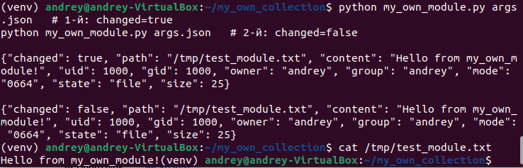
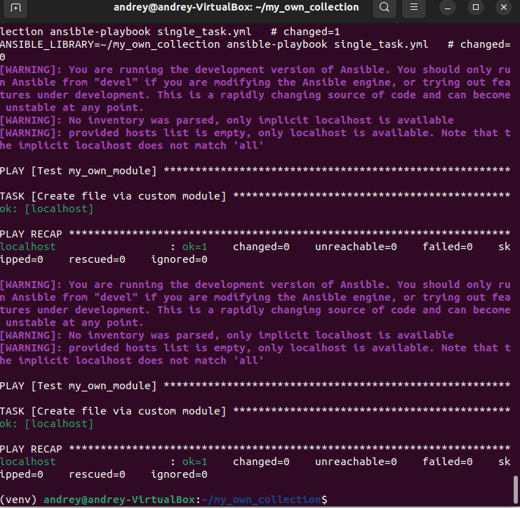
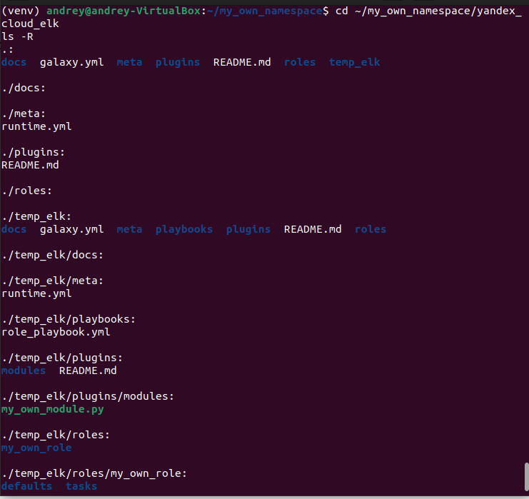
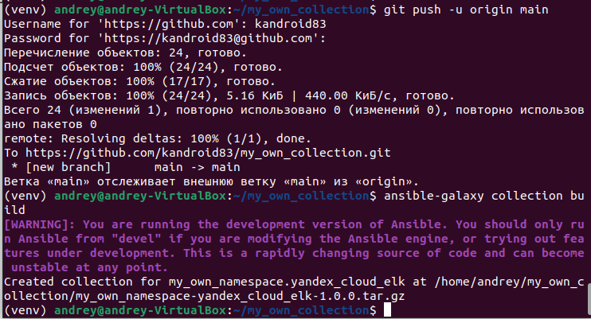
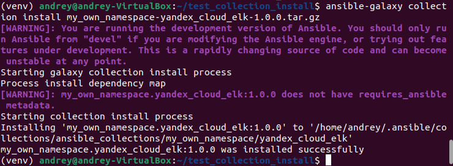
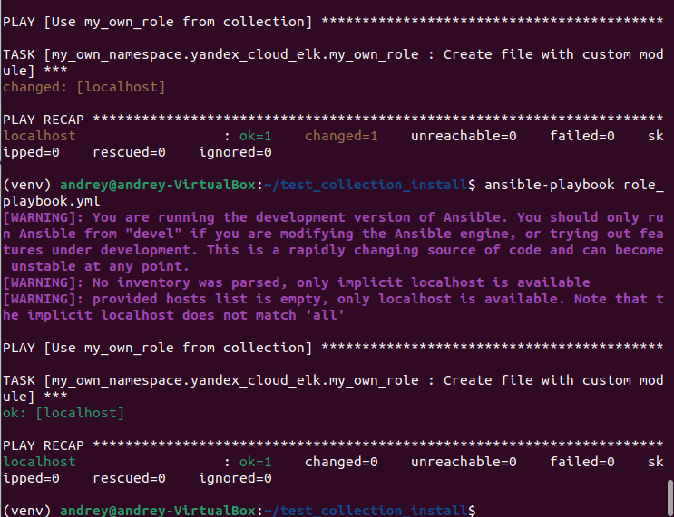

# Домашнее задание к занятию 6 «Создание собственных модулей»

**Репозиторий:** [my_own_collection](https://github.com/kandroitd83/my_own_collection)

## Ссылки
- **Архив коллекции (.tar.gz):** [Скачать](https://github.com/kandroitd83/my_own_collection/blob/main/my_own_namespace-yandex_cloud_elk-1.0.0.tar.gz)

---

## Отчет о выполнении

### 1. Локальная проверка модуля (Шаг 4)
Модуль `my_own_module.py` успешно протестирован локально. При первом запуске `changed=true`, при повторном — `changed=false` (идемпотентность). Файл создан с нужным содержимым.

### 2. Проверка идемпотентности в Playbook (Шаг 6)
Single task playbook `single_task.yml` выполнен дважды. Второй запуск показал `changed=0`, что подтверждает идемпотентность.

### 3. Структура коллекции (Шаги 8-11)
Коллекция инициализирована, модуль перенесен, роль `my_own_role` с параметрами по умолчанию создана.

### 4. Сборка и отправка (Шаги 12-13)
Коллекция отправлена в репозиторий и собран архив `my_own_namespace-yandex_cloud_elk-1.0.0.tar.gz`.

### 5. Установка из архива (Шаг 15)
Коллекция успешно установлена из локального архива.

### 6. Запуск Playbook (Шаг 16)
Playbook с ролью из установленной коллекции выполнен. Первый запуск: `changed=1`. Второй запуск: `changed=0` (идемпотентность подтверждена).

